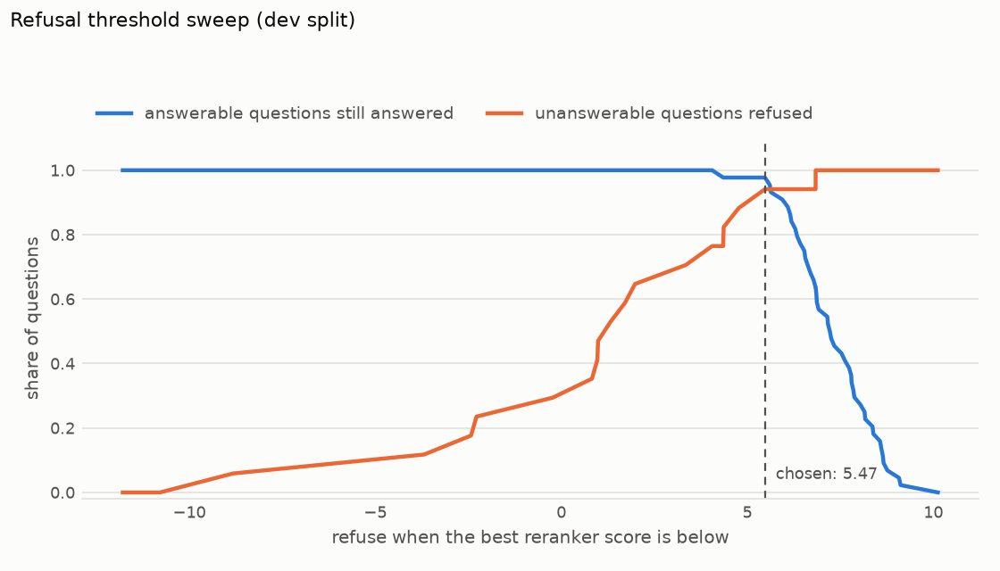

# Results

All numbers come from the commands in the [README](../README.md#reproduce-the-evaluation). The 156 evaluation
questions were split 50/50 into **dev** and **test** by a hash of the question id. Every choice (prompt,
refusal threshold, number of candidates to rerank) was made on dev. The test split was run **once**, at the
end, with `--final`. Intervals are 95% bootstrap intervals over questions. With 95 test questions, differences
of a few points are not meaningful.

| | dev | test |
|---|---|---|
| answerable questions | 44 (37 synthetic, 7 hand-written) | 72 (64 synthetic, 8 hand-written) |
| unanswerable questions | 17 | 23 |
| total | 61 | 95 |

*Synthetic* questions were written by an LLM from the abstract that is their gold answer.
*Hand-written* questions were written and labelled by the author, with gold papers chosen by hand.
*Unanswerable* questions are 20 out-of-domain ones (other diseases, geography, cooking) and 20 near-misses
about glioma that the abstracts cannot answer (prices, hospitals, legal questions, the future).

## 1. Final test-set results (system as shipped)

Settings: hybrid search, rerank 20 candidates, 5 passages to the model, refusal threshold 5.0, prompt v3,
`openai/gpt-oss-120b` on Groq as the answer model.

| metric | test |
|---|---|
| right decision (answered an answerable question, or refused an unanswerable one) | 93% [87%, 98%] (n=95) |
| answerable questions answered | 90% [83%, 97%] (65 of 72) |
| unanswerable questions refused | 100% (23 of 23) |
| right paper among the 5 given to the model | 97% [93%, 100%] (70 of 72) |
| answers with a citation on every sentence | 95% [89%, 100%] (n=65) |
| share of sentences that carry a citation | 99% |
| answers that cite a gold paper | 95% [91%, 100%] (n=65) |
| cited sentences supported by their paper (LLM judge) | 98% (112 checked) |
| answers whose cited sentences are all supported (LLM judge) | 97% [93%, 100%] (n=72) |
| time per question, typical / slowest 5% | 16.5 s / 21.8 s |

The faithfulness judge was run on the 72 answers the model wrote, including 7 that the threshold would hide.
No sentence was judged unsupported; 2 of 112 cited sentences were "partial" (see section 5).

## 2. Retrieval: which search method finds the right paper?

Recall@5 is the share of questions whose gold paper is among the top 5. MRR@10 rewards ranking it higher.
One passage (title plus abstract) per paper, 30,000 papers. Only answerable questions are scored.

**Test** (n=72: 64 synthetic, 8 hand-written)

| method | recall@5 all | MRR@10 all | recall@5 hand-written | MRR@10 hand-written | recall@5 synthetic | MRR@10 synthetic | median ms |
|---|---|---|---|---|---|---|---|
| BM25 (keywords) | 0.96 | 0.92 | 0.75 | 0.56 | 0.98 | 0.97 | 217 |
| dense (bge-small) | 0.94 | 0.80 | 0.88 | 0.56 | 0.95 | 0.83 | 27 |
| hybrid (BM25 + dense, RRF) | 0.97 | 0.92 | 0.88 | 0.72 | 0.98 | 0.94 | 259 |
| hybrid + rerank 10 | 1.00 | 0.89 | 1.00 | 0.79 | 1.00 | 0.90 | 865 |
| hybrid + rerank 20 (shipped) | 0.97 | 0.88 | 1.00 | 0.79 | 0.97 | 0.89 | 1,477 |
| hybrid + rerank 50 | 0.94 | 0.87 | 1.00 | 0.79 | 0.94 | 0.88 | 3,140 |

**Dev** (n=44: 37 synthetic, 7 hand-written)

| method | recall@5 all | MRR@10 all | recall@5 hand-written | MRR@10 hand-written | recall@5 synthetic | MRR@10 synthetic |
|---|---|---|---|---|---|---|
| BM25 | 0.93 | 0.85 | 0.71 | 0.44 | 0.97 | 0.93 |
| dense | 0.93 | 0.77 | 1.00 | 0.46 | 0.92 | 0.83 |
| hybrid | 0.93 | 0.84 | 0.86 | 0.54 | 0.95 | 0.90 |
| hybrid + rerank 10 | 0.95 | 0.86 | 1.00 | 0.67 | 0.95 | 0.89 |
| hybrid + rerank 20 | 0.98 | 0.82 | 1.00 | 0.58 | 0.97 | 0.87 |
| hybrid + rerank 50 | 0.98 | 0.80 | 1.00 | 0.56 | 0.97 | 0.85 |

Charts: `docs/retrieval_abstract_dev.png`, `docs/retrieval_abstract_test.png`.

What to take from this:

- **On this corpus every method puts the right paper in the top 5 most of the time** (recall@5 of 0.93 or
  higher on both splits). The differences between methods in recall are mostly inside the confidence intervals.
- **The synthetic questions flatter keyword search.** They are written from the abstract itself, so they share its
  words with it. BM25 has the best MRR on them (0.97 on test) and the worst recall on the hand-written
  questions (0.75). A system tuned only on synthetic questions would conclude that reranking does not help.
- **On the hand-written questions, which use ordinary wording, reranking helps ranking**: MRR@10 goes from
  0.44 (BM25) to 0.67 on dev and from 0.56 to 0.79 on test. There are only 7 and 8 such questions, so this is
  suggestive, not proof.
- **Rerank 20 was chosen on dev**, where it had the best recall@5 (0.98 vs 0.95 for rerank 10). On test the
  order flipped (1.00 for rerank 10, 0.97 for rerank 20, which is 2 questions). The setting was not changed after
  seeing the test result.
- Reranking 50 candidates costs 2 to 3 seconds per question and was never better.

## 3. Refusal: when should the system decline?

There are two layers. **Layer 1:** if the best reranker score is below a threshold, no answer is written
(and no model call is made). **Layer 2:** the model itself may reply `INSUFFICIENT_EVIDENCE`
(prompt v2 and v3 tell it to do so for off-topic questions and for passages that do not directly answer).

On dev, scores between 4.4 and 5.4 keep 98% of answerable questions while refusing 82% to 94% of unanswerable
ones, a plateau. The threshold was set to **5.0**, in the middle of it, before the test split was touched.

| layer | dev (17 unanswerable) | test (23 unanswerable) |
|---|---|---|
| score threshold 5.0 alone | refused 16, leaked 1 (`uo15`, score 6.8) | refused 23, leaked 0 |
| model refusal alone (prompt v3) | refused 13, leaked 4 (`uo12`, `uo13`, `un03`, `un20`; scores -0.2 to 4.4) | refused 22, leaked 1 (`un13`, score -0.5) |
| both layers | 0 leaked | 0 leaked |

Each layer alone leaks, and they leak different questions. The threshold misses a look-alike question that
scores high because it uses words that match glioma papers (`uo15`). The model misses questions that are loosely
related to a retrieved paper, for example driving after brain surgery in the UK (`un13`). Using both gave no
leaks on 40 unanswerable questions. That is a small set, so a leak rate of a few percent cannot be ruled out.

**The cost of the threshold** is over-refusal: on test it refused **6 of 72** answerable questions, all with
scores between 4.3 and 4.9, just below the cut. When the threshold was switched off, the model did write answers
to them. One more answerable question (`s35223453`, score 5.7) was refused by the model. That is why 90%, not
100%, of answerable questions were answered. A lower threshold would answer more and, given the second layer,
might lose nothing, but that is a conclusion from test data, so it is reported here and not applied.

## 4. Answer quality: the prompt matters

The same questions were answered with three prompts (`generate/prompt.py`), on the 44 dev questions that all
runs share.

| | v2 | v3 |
|---|---|---|
| right decision (answer or refuse) | 95% | 95% |
| sentences that carry a citation | 84% | 98% |
| answers with a citation on every sentence | 52% | 92% |
| gold paper cited | 100% | 100% |
| cited sentences supported (judge, own sample) | 98% (85 checked) | 96% (54 checked) |

v1 (plain "answer from the passages and cite them") let a high-scoring off-topic look-alike question through; v2 added an explicit
"is this about glioma research and do the passages answer it?" check, which fixed that. In v2, about a quarter of
the sentences had no citation, mostly closing "Overall, ..." summaries that claimed more than the papers did.
v3 requires a citation on every sentence and forbids introductions and summaries. It made no difference to which
questions were answered, and on test 95% of answers have a citation on every sentence.

**Local versus hosted model.** The same pipeline with a 3-billion-parameter model running locally
(`qwen2.5:3b` through Ollama) refused almost every answerable question (about 9% answered on dev), because it
replies `INSUFFICIENT_EVIDENCE` too eagerly. The hosted `openai/gpt-oss-120b` is what makes the system usable.
The cost is speed: 16 s per question, of which about 15 s is the model call and 1.4 s is search plus reranking.

## 5. Is the citation checker enough? Faithfulness

The citation checker proves that every cited PMID is one of the 5 papers retrieved for the question. It does **not**
prove that the paper supports the sentence. A separate **LLM judge** (`openai/gpt-oss-20b`) reads each cited
sentence with its cited paper and says supported, partial or unsupported.

How far to trust the judge:

- **Wrong-paper controls.** Sentences from real answers were paired with an unrelated paper. The judge flagged
  **10 of 10** as not fully supported.
- **Agreement with a human.** The author labelled 30 sentences by hand, using only the cited abstract. The judge
  agreed on 28 (93%). In both disagreements the judge said "partial" and the sentence contained a detail that is
  missing from the cited abstract (a "13% of cases" figure; "lymphoid tissues"). Because the human labels were
  almost all "supported", kappa is not informative here (0.00 by construction) and is not reported as a result.
- The judge and the answer model are from the same model family, which can make a judge too forgiving. The
  controls and the hand check are the evidence against that, and they are small.

Results on test (72 answers, 115 sentences, 112 cited): **98% of cited sentences supported, 2% partial,
0% unsupported**; 97% of answers had every cited sentence supported. Three sentences had no citation.
The two partial verdicts:

- `h009`: says BRAF inhibitors "most commonly" include vemurafenib; the cited abstract names dabrafenib and
  trametinib only.
- `h017`: links re-irradiation plus bevacizumab to better survival; the abstract reports a median survival but no
  comparison with treatment without bevacizumab.

## 6. Failure analysis

Where the system fell short on test, by cause:

1. **Retrieval missed the gold paper (`s34135908`).** The question asked how glioma extracellular vesicles affect
   immune cells. The paper it was written from was not in the 5 passages. The model wrote a fully cited, sensible
   answer from three related papers. The citation checker passed it, because those papers *were* retrieved. This
   is the main limit of the checker: it validates provenance, not whether the right evidence was found.
2. **Gold paper retrieved, but not cited (`h003`, `h004`).** For the WHO 2021 classification question, the model
   cited one relevant retrieved paper instead of the three listed as gold. The answer looks correct, so this is
   partly a limit of the metric: hand-picked gold lists are incomplete.
3. **Overgeneralising closing sentence (`h004`).** The question was whether tumour treating fields improve
   survival. The model cited three observational cohorts correctly and then added an *uncited* sentence: "These
   findings collectively indicate that TTFields therapy improves overall survival." Three uncontrolled series
   do not show that. This is the failure that prompt v3 was written to remove. It dropped from about a quarter of
   sentences to 3 of 115, but not to zero.
4. **Over-refusal at the threshold:** 6 answerable questions refused with scores of 4.3 to 4.9 (section 3).
5. **A near-miss that was partly answerable (`un13`).** "Can I legally drive a car after a glioma operation in
   the UK?" is not answered by the abstracts as a legal question, but one retrieved paper reviews return to driving
   after craniotomy. The model answered from it. The score (-0.5) made the threshold refuse it. This is a
   borderline question that was labelled unanswerable.

## 7. Limitations

- **The evaluation is small.** 95 test questions, of which 8 are hand-written. Confidence intervals are wide,
  and a 1-to-3 point difference between two settings is noise.
- **Most questions are synthetic.** They are easier and flatter keyword search (section 2). The hand-written
  questions are the more realistic test, and there are few of them.
- **Gold labels are incomplete.** For hand-written questions several papers may answer the question. "Gold paper
  cited" under-counts correct answers (section 6, case 2). Nobody has rated answer correctness by hand across the
  test set.
- **The judge is an LLM**, validated on 30 hand-labelled sentences and 10 controls. It can be wrong in either
  direction.
- **One corpus, one reranker, one answer model.** The threshold of 5.0 belongs to this reranker's score scale. If
  the reranker or the corpus changes, it must be re-chosen. Hosted models also change over time.
- **The corpus is abstracts only**, a 30,000-paper random sample of the glioma abstracts that were fetched, so
  full-text findings, newer papers and papers outside the sample are not covered.
- **It is slow and rate-limited.** 16 s per question on a free hosted model, and a free daily allowance. The demo
  caps the number of live answers per day and serves saved answers for its example questions.
- **Not medical advice.** It is a research tool. It can be wrong even when every sentence is cited.
